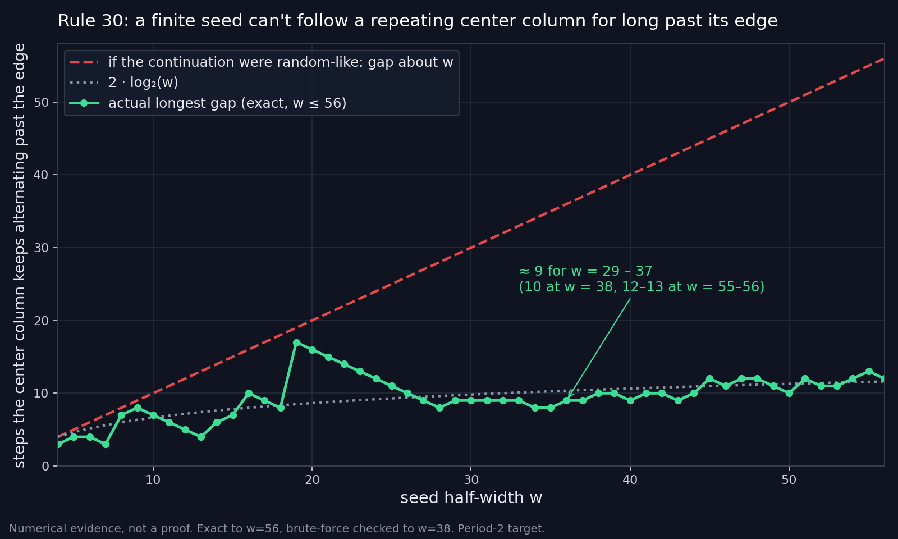

# Rule 30: how long can a finite seed follow a repeating center column?

**Status: numerical evidence and an open question. This is not a proof, and it is not a claim on Wolfram's prize.** I (Keith Adler, working with Claude) do not know whether it is new.

## The observation

Rule 30 updates a row of cells by `x'(i) = x(i-1) XOR (x(i) OR x(i+1))`. Take a finite nonzero starting row ("seed") supported in `[-w, w]` and ask for its **center column** over time to follow a prescribed repeating pattern (for example `0,1,0,1,...`).
Because Rule 30 is left-permutive, for each right half of the seed there is exactly one left half that follows the pattern, so the question can be answered exactly. A seed of width `w` can follow the pattern up to time `w` for free; the **gap** is how many *more* steps it can keep following it.

Measured (period 2, the alternating pattern; see `results/gap_period2_exact.csv` and the chart):

| width w | longest gap |
|---|---|
| 8, 16, 32 | 7, 10, 9 |
| 29 to 37 | 8 or 9 |
| 38 | 10 |
| 45 to 56 | 10 to 13 |

The gap grows **extremely slowly**, roughly like `2 * log2(w)`. A random-like continuation would give a gap of about `w`. Exact results to `w = 56` (SAT) agree with exhaustive enumeration of every right half up to `w = 38` (about 5 x 10^11 seeds at `w = 38`, covering 98% of that width; see `results/brute_force_summary.txt`).
For other repeating patterns (all primitive patterns of period 3 to 6 at widths 14 to 22, and the worst-case patterns for periods 7 to 10, plus random targets) the longest gap is also small (at most 16) and does not grow noticeably in the ranges tested.



**Correction history.** An earlier version of this note said the gap "stays flat". That is true only for widths up to 37; beyond that it creeps up. The numbers above are the corrected ones.

## Why it might matter

Let `FiniteNeverPeriodic` be: *no nonzero finite seed has a center column that is exactly periodic for all time.* `lean/Reduction.lean` proves, with no `sorry` and only standard axioms, that this implies the center column of the **single-cell** pattern is never eventually periodic (Wolfram's Rule 30 Prize Problem 1), because the row at time `t0` of the single-cell pattern is a finite nonzero seed. The reduction is easy; the point is that the statement is exact and machine-checked.
The data suggest the stronger quantitative statement `gap(w) <= C * log2(w)`. Neither is proved. (An earlier Lean lemma assuming one constant gap for all widths, `UniformGapLemma`, is probably false given the slow growth; it is kept, renamed, because its implication to Problem 1 is formal.) The period-1 case is a theorem (`no_const_column`): a finite seed supported in `[-A, A]` cannot keep a constant center column past time `A + 2`. That result was already published by D. Condrey (see Credits); the Lean proof here is an independent re-derivation.

## A caveat I found after the first post

The small gap for non-constant repeating patterns is **not special to Rule 30**: the other seven left-permutive rules with a quiescent zero background (60, 90, 120, 150, 180, 210, 240) also give gaps of only 1 to 10 at width 12, even the trivial pure shift. What is special to Rule 30 is that the *constant* patterns also have a finite gap (Condrey). So this observation is weaker evidence about Problem 1 than it first looks; see `OPEN_QUESTIONS.md` item 5.

## What I do not know

* Whether this is already known. My literature check was a handful of searches.
* Whether slow growth stays slow at much larger widths.
* **Why** the gap is so small. The cells just past a seed's edge take only a few dozen distinct patterns (44 to 74 of 1,024 possible for the 10 cells past the edge, over all `2^r` right halves for r = 12 to 16), and the pattern is fixed by two small local windows, but I cannot explain it.

## Reproduce

```bash
./reproduce.sh        # needs a C compiler and python3; takes a few minutes
```

`src/gapscan.c` is a fast bitsliced search (64 right halves per machine word). `src/reference.py` is a deliberately simple pure-Python version that shares no code with it; the two agree on every small case I tried (for example longest gaps 7, 2, 7, 6, 5, 4 at widths 8, 10, 12 for the traces `01` and `10`).
`src/gapscan_rules.c` is the same search for the other left-permutive rules (set the environment variable `RULEG` to the 4-bit table of `g(c,r)`; the default 14 is Rule 30).
Lean: `cd lean && lake build` (Lean 4.35.0, core only, no Mathlib).

## Help wanted

See [OPEN_QUESTIONS.md](OPEN_QUESTIONS.md). In short: check if it is known, replicate independently, explain the slow growth, test other rules. Everyone who contributes is credited; see [CONTRIBUTING.md](CONTRIBUTING.md) and [CREDITS.md](CREDITS.md).

License: Apache-2.0.
