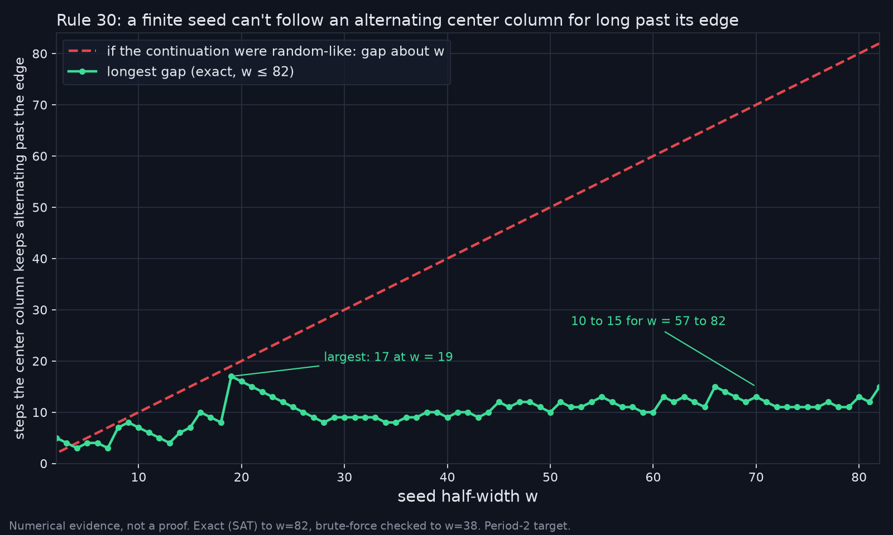

# Rule 30: how long can a finite seed follow a repeating center column?

**Status: numerical evidence and an open question. This is not a proof, and it is not a claim on Wolfram's prize.** I (Keith Adler, working with Claude) do not know whether it is new.

## The observation

Rule 30 updates a row of cells by `x'(i) = x(i-1) XOR (x(i) OR x(i+1))`. Take a finite nonzero starting row ("seed") supported in `[-w, w]` and ask for its **center column** over time to follow a prescribed repeating pattern (for example `0,1,0,1,...`).
Because Rule 30 is left-permutive, for each right half of the seed there is exactly one left half that follows the pattern, so the question can be answered exactly. A seed of width `w` can follow the pattern up to time `w` for free; the **gap** is how many *more* steps it can keep following it.

Measured (period 2, the alternating pattern; every width from 2 to 82 is in `results/gap_period2_exact.csv`). The **horizon** `H(w) = w + gap` is the first time by which no seed of width `w` can still be following the pattern; it is what the SAT search computes, and it can never go down as `w` grows (a seed of width `w` is also a seed of width `w + 1`). The gap is the horizon minus `w`, so it counts down by one per width whenever the horizon stays put.

| width w | horizon H(w) | longest gap |
|---|---|---|
| 8 | 15 | 7 |
| 16 to 18 | 26 | 10 to 8 |
| **19** to 28 | **36** | **17** to 8 |
| 29 to 37 | 38 to 46 | 8 or 9 |
| 38 | 48 | 10 |
| 45 to 56 | 57 to 68 | 10 to 13 |
| 57 to 65 | 68 to 76 | 10 to 13 |
| 66 to 69 | 81 | 15 to 12 |
| 70 to 82 | 83 to 97 | 11 to 15 |

The **largest gap anywhere in the table is 17, at `w = 19`** (about `4 * log2(w)`). From there the horizon stays at 36 until `w = 28`, so the gap falls to 8; beyond that it rises again, slowly: 12 or 13 by `w = 56`, and 15 at `w = 66` and `w = 82`. A random-like continuation would give a gap of about `w`, so the gap is small. Whether it grows, and how, is not settled by this range: a bound `gap(w) <= C * log2(w)` fits only with `C >= 4`, and the gap at `w = 82` is still below the gap at `w = 19`. Exact results to `w = 82` (SAT, `src/mint.py`) agree with exhaustive enumeration of every right half at the widths tested: small widths in `reproduce.sh`, and `w = 32` to `38` on rented machines (about 5 x 10^11 seeds at `w = 38`, covering 98% of that width; see `results/brute_force_summary.txt`).
For other repeating patterns (all primitive patterns of period 3 to 6 at widths 14 to 22, and the worst-case patterns for periods 7 to 10, plus random targets) the longest gap is also small (at most 16) and does not grow noticeably in the ranges tested.



The chart is drawn from the CSV by `src/plot_gap.py` (needs matplotlib).

**Correction history.** The first version of this note said the gap "stays flat". A second version said it grows "roughly like `2 * log2(w)`", using the widths 8, 16 and 32 and leaving out the rows for widths 17 to 28, where the gap reaches 17. The table above shows every range, and the full table is in the CSV.

## Why it might matter

Let `FiniteNeverPeriodic` be: *no nonzero finite seed has a center column that is exactly periodic for all time.* `lean/Reduction.lean` proves, with no `sorry` and only standard axioms, that this implies the center column of the **single-cell** pattern is never eventually periodic (Wolfram's Rule 30 Prize Problem 1), because the row at time `t0` of the single-cell pattern is a finite nonzero seed. The reduction is easy; the point is that the statement is exact and machine-checked.
A stronger quantitative statement, `gap(w) <= C * log2(w)`, is consistent with the data, but only with `C >= 4`, and widths to 82 cannot tell it apart from other slow growth laws. Neither is proved. (An earlier Lean lemma assuming one constant gap for all widths, `UniformGapLemma`, is probably false given the growth beyond `w = 28`; it is kept, renamed, because its implication to Problem 1 is formal.) The period-1 case is a theorem (`no_const_column`): a finite seed supported in `[-A, A]` cannot keep a constant center column past time `A + 2`. That result was already published by D. Condrey (see Credits); the Lean proof here is an independent re-derivation.

## A caveat I found after the first post

The small gap for non-constant repeating patterns is **not special to Rule 30**: the other seven left-permutive rules with a quiescent zero background (60, 90, 120, 150, 180, 210, 240) also give gaps of only 1 to 10 at width 12, even the trivial pure shift. What is special to Rule 30 is that the *constant* patterns also have a finite gap (Condrey). So this observation is weaker evidence about Problem 1 than it first looks; see `OPEN_QUESTIONS.md` item 5.

## What I do not know

* Whether this is already known. My literature check was a handful of searches.
* Whether slow growth stays slow at much larger widths.
* **Why** the gap is so small. The cells just past a seed's edge take only a few dozen distinct patterns (44 to 74 of 1,024 possible for the 10 cells past the edge, over all `2^r` right halves for r = 12 to 16), and the pattern is fixed by two small local windows, but I cannot explain it.

## Reproduce

```bash
./reproduce.sh        # needs a C compiler and python3; takes a few minutes
```

`src/gapscan.c` is a fast bitsliced search (64 right halves per machine word). `src/reference.py` is a deliberately simple pure-Python version that shares no code with it; the two agree on every small case I tried (for example longest gaps 7, 2, 7, 6, 5, 4 at widths 8, 10, 12 for the traces `01` and `10`).
The exact horizons in the CSV come from a SAT search with CaDiCaL, through `python-sat`:

```bash
python3 -m venv .venv && .venv/bin/pip install python-sat
PYTHONPATH=src .venv/bin/python src/mint.py 2 8 19 29   # prints the horizon H(w) for period 2 at w = 8, 19, 29: 15, 36, 38
```

`src/sat_period.py` encodes "some nonzero seed in `[-A, A]` has a center column with period `p` on times `t0 .. T`" as CNF, keeping only cells that can reach the center by time `T`. `src/mint.py` searches for the first `T` that is UNSAT. Run directly, `sat_period.py` also checks every SAT answer by simulating the seed it finds. On a laptop, `w = 29` takes about a second, `w = 45` about 20 seconds and `w = 82` about 3.6 hours; widths 83 to 86 had not finished after three hours each. The solver's UNSAT answers are not independently certified (no DRAT/LRAT proof is written).
`src/gapscan_rules.c` is the `gapscan.c` search for the other left-permutive rules (set the environment variable `RULEG` to the 4-bit table of `g(c,r)`; the default 14 is Rule 30).
Lean: `cd lean && lake build` (Lean 4.36.0, core only, no Mathlib). This also builds `Period2.lean` and `Repeat.lean`.
Second kernel: [Tenet](https://github.com/keithadler/tenet), an independent Lean kernel in C# (commit `985ab13`), re-checked the four compiled files and everything they import with `tenet check .lake/build/lib/lean/Repeat.olean --all` (and the same for the other three): about 65,000 declarations in 672 modules each time, 0 failed. `tenet axioms` reports the same axioms as Lean for each main theorem. Tenet is by the same author as this repo, so it is a second implementation, not a second party.

## Period 2: an attempt at a proof

[PERIOD2_NOTES.md](PERIOD2_NOTES.md) records a failed attempt to prove the period-2 case, and what it found: the problem splits into a left side and a right side, the small gap comes from the right side, and an alternating center column sits inside a known Rule 30 background of spatial period 155. It also records a computer check that found no counterexample among seeds with right width up to 16 and left width up to 9,986. Two lemmas from it are proved in Lean: a forced cell (`lean/Period2.lean`) and a bound on how early the column next to the center can repeat (`lean/Repeat.lean`).

## Help wanted

See [OPEN_QUESTIONS.md](OPEN_QUESTIONS.md). In short: check if it is known, replicate independently, explain the slow growth, test other rules. Everyone who contributes is credited; see [CONTRIBUTING.md](CONTRIBUTING.md) and [CREDITS.md](CREDITS.md).

License: Apache-2.0.
